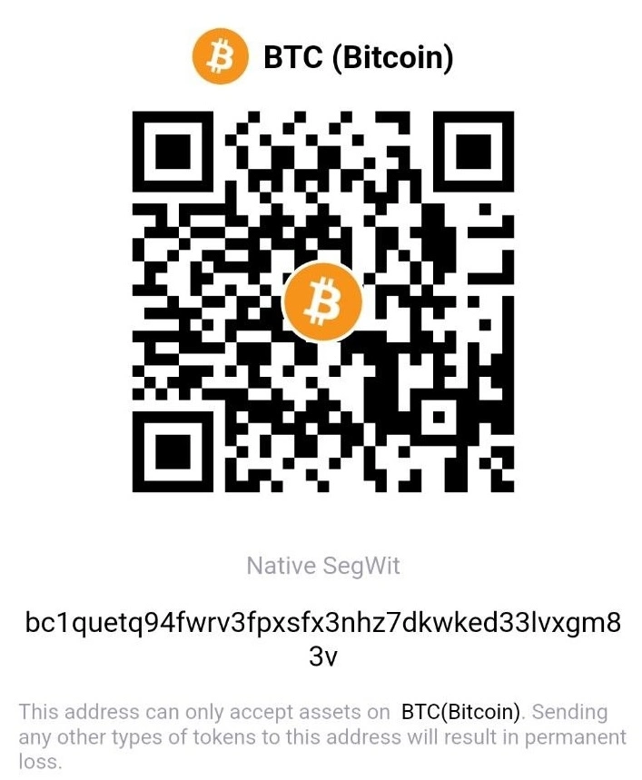
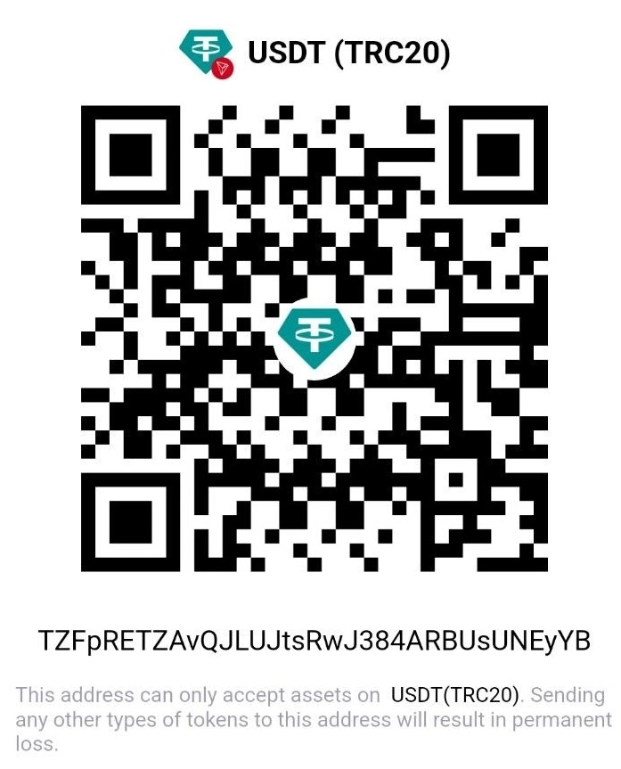

# Support LiterallyTheOne ❤️

I create free programming tutorials, technical articles, and open-source projects.

If my work has helped you learn something or solve a problem, you can support me with a voluntary donation.

Every contribution helps me dedicate more time to creating educational content.

## Donate with Bitcoin



BTC(Bitcoin):

```text
bc1quetq94fwrv3fpxsfx3nhz7dkwked33lvxgm83v
```

> The address above only accepts assets on BTC(Bitcoin).
> Sending any other types of tokens to this address will
> result in permanent loss.

## Donate with Tether



USDT(TRC20):

```text
TZFpRETZAvQJLUJtsRwJ384ARBUsUNEyYB
```

> The address above only accepts assets on USDT(TRC20).
> Sending any other types of tokens to this address will
> result in permanent loss.
